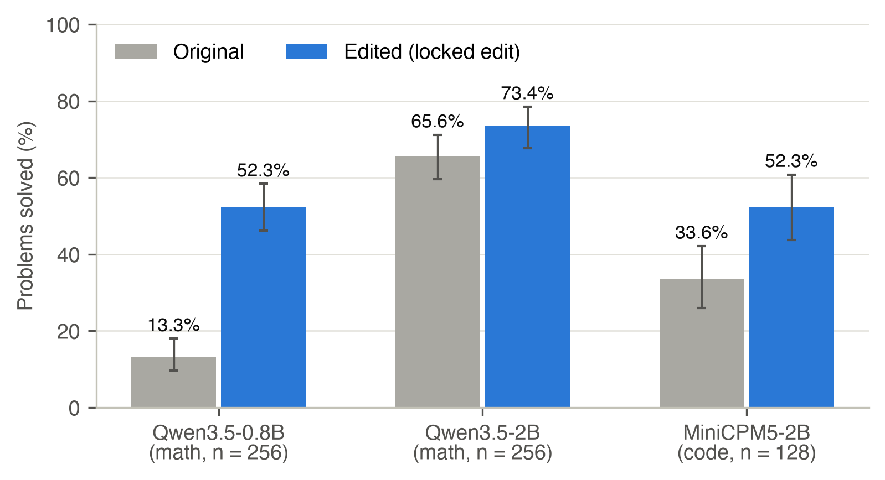
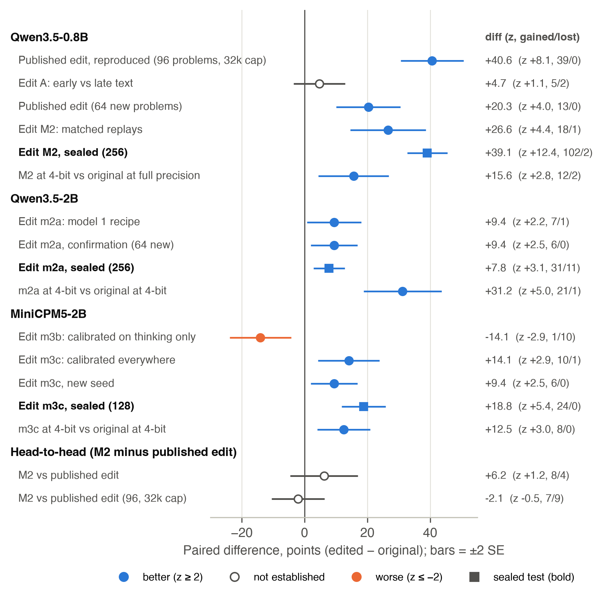
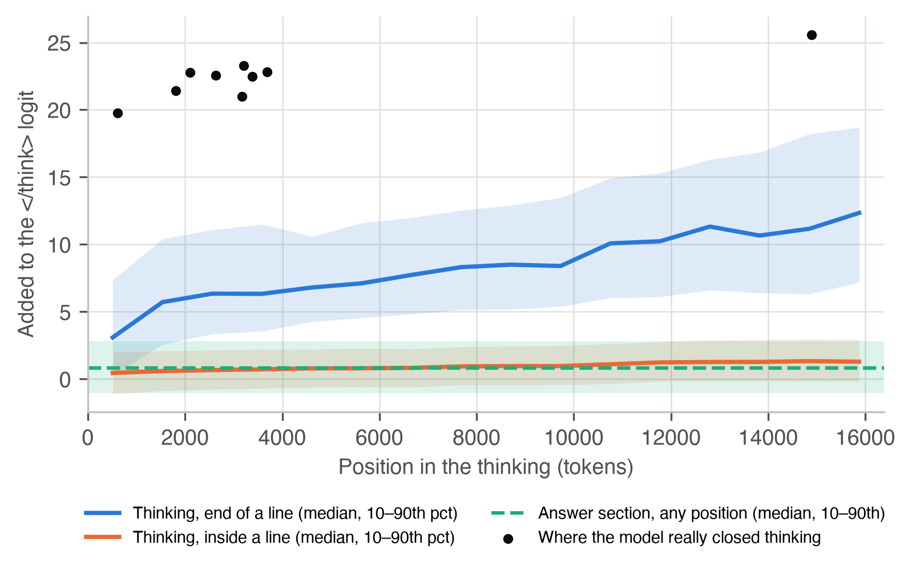
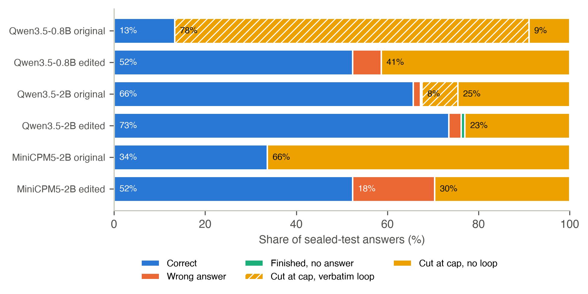
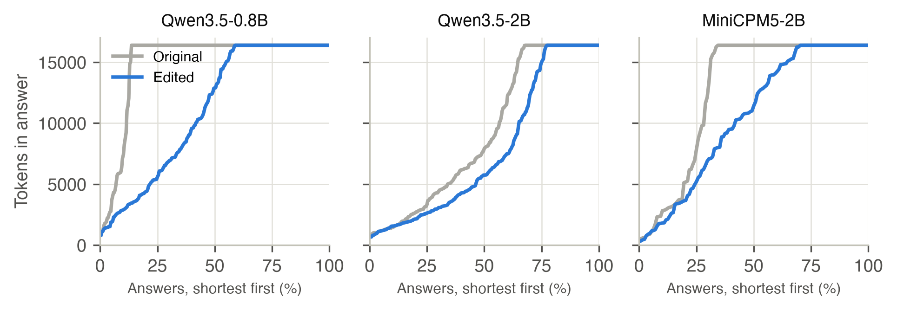
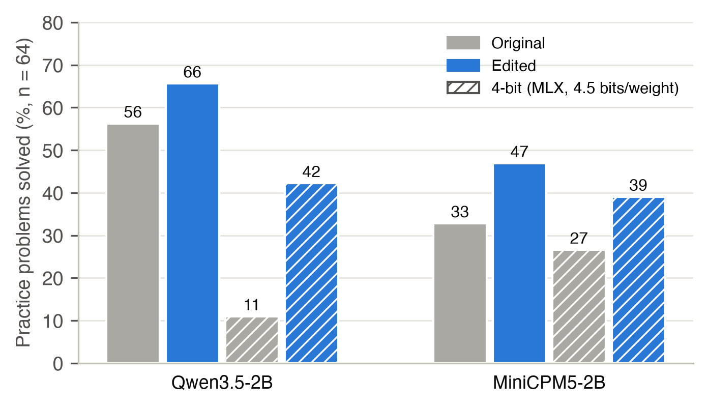

# Patching the Weights

Fixing small reasoning models by editing their weights directly: no training, no gradients, one laptop.

**Paper:** [Patching the Weights: Direct Edits Fix Non-Terminating Reasoning in Three Small Language Models](https://github.com/ajinkyalahade/LLM-Weight-Space-Training/blob/main/paper_APA.docx) (APA, .docx)

Small reasoning models often fail by never finishing: they loop, or keep re-checking until the token budget runs out.
Following [*Sparks of Weight-Space Programming*](https://rikiyat.github.io/blog/weight-space-programming/)
(Takehi, Teoh, Zhang & Khattab, MIT CSAIL, 2026), an AI coding agent (Claude Code) diagnosed and edited three open
models under fixed rules, and each locked edit was tested once on problems it had never seen.

## Results (sealed tests, run once after locking)

| Model | Task | Original | Edited | Gained / lost | Margin | Weights changed |
|---|---|---|---|---|---|---|
| Qwen3.5-0.8B | math, 256 problems | 13.3% | **52.3%** | 102 / 2 | 12.4 SE | 131,072 (2 MLP layers) |
| Qwen3.5-2B | math, 256 problems | 65.6% | **73.4%** | 31 / 11 | 3.1 SE | 262,144 (2 MLP layers) |
| MiniCPM5-2B | code, 128 problems | 33.6% | **52.3%** | 24 / 0 | 5.4 SE | 2,048 (one output row) |



- No measurable harm: MMLU-200 moved by at most 1 point; perplexity on prose and code by at most 2%.
- The edits survive MLX 4-bit export and still beat the unedited 4-bit models.
- 4 of 7 own edit attempts failed; all are reported. The edits don't make models smarter: they let them finish.

Every edit we tested, as a problem-by-problem difference from its own original (bars ±2 SE; squares are the sealed
tests):



Paper (APA): [`paper_APA.docx`](paper_APA.docx). Figures and every number behind them:
[`writeup/figures/`](writeup/figures/).

## How the edits work

- **Qwen3.5-0.8B and 2B (thinking loops).** Replay an answer several times from just before it loops; some replays
  loop and some don't. The difference in hidden state is a "stuck" direction. Reverse it in the 64 MLP output neurons
  per layer (layers 15 and 19) that write it most. Matches the published fix for the 0.8B model and transfers
  unchanged to the 2B.
- **MiniCPM5-2B (never stops re-checking).** Add a vector to the `lm_head` row of `</think>`, built from two
  regularized linear discriminants of the final hidden state ("about to finish" and "late in a long thinking"). The
  model already tracks how long it has been thinking; the edit links that signal to the token that ends the thinking.
  It had to be calibrated on line ends, line interiors and the answer section, or it fired in the wrong places.

What the MiniCPM5-2B edit adds to the `</think>` score, by position in the thinking: it grows with elapsed length at
line ends and stays low inside lines and in the answer.



## More results

What happened to each sealed-test answer: the edits turn answers cut off at the token cap into finished answers.



Answer lengths on the sealed tests, shortest first. A flat top at 16,384 tokens means the answer was cut off.



At 4-bit (MLX), the edited models still beat the unedited 4-bit models. For Qwen3.5-2B, 4-bit conversion alone breaks
the unedited model, and the edit recovers most of it.



## What is here

```
wsp/                 all code: generation, grading, sandbox, probing, editing, statistics, graphs
runs/<model>/        REPORT.md (results), notes.md (dated lab notebook), passes.jsonl (every test run),
                     edits/<id>/ (each edit: manifest + changed weights), graphs/, passes/*/summary.json
writeup/figures/     figures for the paper (make_figures.py, facts.json)
data/                problem lists and sealed-set definitions
plan.md              the rules and end goal, fixed before testing
DATA.md              files not in the repo (models, raw answers, datasets) and how to get them
```

## Setup

Needs an Apple silicon Mac (MLX for inference; `sandbox-exec` to run model-written code).

```sh
uv venv --python 3.12
uv pip install mlx==0.32.4 mlx-lm==0.32.2 numpy math-verify==0.9.0 matplotlib huggingface_hub
hf download openbmb/MiniCPM5-2B --local-dir models/MiniCPM5-2B
.venv/bin/python -I wsp/sandbox.py --selftest        # checks the code sandbox blocks network and file access
```

Run an edited model without changing the original files:

```python
import sys; sys.path.insert(0, "wsp")
import lm
model, tok = lm.load("models/MiniCPM5-2B", "runs/minicpm5-2b/edits/m3c")   # base model + edit
```

A generation pass (answers, grades, ledger line), for example the MiniCPM5-2B practice set:

```sh
.venv/bin/python -I wsp/generate.py --run runs/minicpm5-2b --model models/MiniCPM5-2B \
    --edit runs/minicpm5-2b/edits/m3c --label m3c --problems runs/minicpm5-2b/problems_practice64.json \
    --data data/minicpm5-2b/lcb/problems.jsonl --protocol minicpm_code --max-tokens 16384 --batch 16 --seed 0
```

Each tool in `wsp/` documents its own usage at the top of the file. `data/minicpm5-2b/lcb/problems.jsonl` is built
with `wsp/lcb.py` from the LiveCodeBench dataset (see `DATA.md`).

## Rules every model followed

Two days, at most three own edit attempts, at most 50 test runs. Practice, collection and sealed problems split
before any run. The edit is locked (file hash recorded) before the sealed test, which runs once. Pass: the edited
model beats its own original by at least two standard errors, problem by problem, with no harm on general knowledge
and a working 4-bit export.

## Credits

The idea and the original Qwen3.5-0.8B fix are from Takehi, Teoh, Zhang & Khattab (2026); their logs are at
[RikiyaT/lm_understand-logs](https://github.com/RikiyaT/lm_understand-logs). `wsp/grade.py` reuses their answer
extraction and loop test (MIT License; notice kept in the file).

## Contact

Ajinkya Lahade, ajinkyalahade@outlook.com. Models, raw answers and measurement files are available on request
(see [`DATA.md`](DATA.md)).
